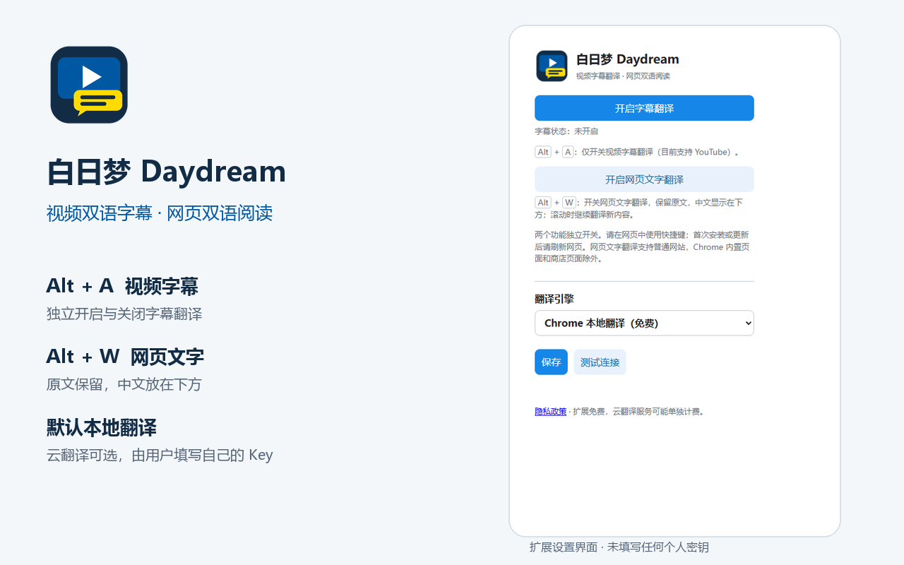

# 白日梦 Daydream

YouTube 双语字幕与网页文字翻译工具。项目发起与维护：**hesay77-cmyk**，采用 [MIT 许可证](LICENSE)。



## 下载与安装

**[从 Chrome 应用商店安装白日梦 Daydream](https://chromewebstore.google.com/detail/dnpdkhjoephecffekgldnaooolnffeih)**

打开商店页面，点击“添加至 Chrome”即可安装，无需开启开发者模式。后续更新由 Chrome 应用商店分发。

需要手动安装或检查源码时，可在 [GitHub Releases](https://github.com/hesay77-cmyk/daydream-translator/releases/latest) 下载安装包与完整源码。手动安装：解压 `daydream-1.18.0.zip`，在 Chrome 打开 `chrome://extensions`，开启“开发者模式”，选择“加载已解压的扩展程序”，加载包含 `manifest.json` 的目录。

需要 Chrome 138 或更新版本。本地翻译和语言检测的可用性取决于 Chrome 与设备支持，首次使用可能下载语言模型。安装或更新后，请刷新原先已打开的网页。

## 怎么用

- **视频字幕**：打开带有原语言字幕的 YouTube 视频，按 `Alt+A` 开启或关闭双语字幕，也可以在插件面板中控制。获取到时间轴时按字幕时间显示；时间轴不可用时跟随原生字幕。字幕支持拖动，双击恢复位置。
- **网页文字**：按 `Alt+W` 独立开启或关闭。保留原文，中文显示在下方，滚动时逐步处理新内容。
- 两个开关独立工作，请在网页中使用快捷键；输入框内不会触发。Chrome 内置页面、商店页面等受保护页面不支持网页翻译。

默认引擎是 Chrome 本地翻译，无需填写云服务密钥。也可以自行选择腾讯云或豆包，配置自己的凭据、模型或接入点。项目不提供共享密钥；云服务可能按服务商规则收费。豆包的代码内默认模型名为 `doubao-seed-translation-250915`，实际可用性以服务商账户和接口为准。

视频字幕仅处理 YouTube 已有字幕，不识别无字幕视频的音频。开启后可以预翻译未来约 5 分钟字幕，并按引擎、模型、内容类型和保留词隔离缓存，缓存上限约 8 MB。

## 1.18.0 的字幕上下文更新

- 相邻批次携带前面最多 2 条字幕原文，在明显停顿处停止回看；历史译文不覆盖。
- 尽量在句末分批，结合停顿与长度限制，每批最多 20 条。实际请求使用 900 UTF-8 字节的保守预算，这不是精确的模型 token 计数。
- 已缓存的相邻原文仍可提供上下文，豆包时间轴字幕按视频和字幕位置隔离缓存，避免复用错语境。
- 长内容自动缩小批次或分段处理；字幕编号缺失、重复或无法对应时回退逐条翻译。
- 保留字幕时间轴、有限重试、过期隐藏、请求共享和优先级；未新增权限或第三方依赖。

当前源码及 GitHub 安装包版本为 **1.18.0**。Chrome 商店的 1.18.0 更新已提交审核，正式分发版本以商店页面显示为准。

## 保留的稳定性处理

- 临时失败最多尝试 3 次，后续缓存到达仍可恢复；失败时恢复原生字幕。
- 到达字幕结束时间就隐藏，不延长静音间隔或最后一句。
- 当前字幕优先于预读，预读优先于网页文字；当前请求可提升尚未开始的预读。
- 相同翻译共享进行中的请求，减少重复调用。

## 隐私与署名

设置、云服务凭据和翻译缓存保存在本机扩展存储。云翻译会把选定的网页片段或字幕发送到用户选择的服务商。本项目没有翻译中转服务器、广告或统计 SDK。

网页翻译的内容脚本声明了普通 HTTP/HTTPS 网页范围；字幕逻辑在 YouTube 页面工作。原始字幕可能在开启翻译前载入页面内存。具体处理方式见 [隐私政策](PRIVACY.md)。

- [MIT 许可](LICENSE) · [署名与贡献说明](AUTHORS.md)
- [反馈问题](https://github.com/hesay77-cmyk/daydream-translator/issues)：请勿提交 API Key、SecretKey、私密网页文字或原始个人记录。
- [公开发行来源](docs/SOURCE-PROVENANCE.md)

## 开发与验证

运行不依赖 Node.js 或 Python。开发检查使用 Node.js：

```sh
node test-controls.js
node test-shorts.js
node test-background.js
node test-reliability.js
node test-context.js
```

设置、图标和覆盖层视觉检查另需 Playwright；通过 `DAYDREAM_PLAYWRIGHT` 指定现有包路径，或在开发环境中安装 Playwright。`DAYDREAM_CHROMIUM` 可指定独立浏览器程序路径。图标与商店图片生成另需 Python 和 Pillow。

```sh
node test-render.cjs
node test-extension.cjs
python build_release.py
```

构建输出到 `releases/daydream-1.18.0.zip`，已有同版本安装包会保留，构建会停止而不覆盖。安装包包含 MIT 许可，源码包包含运行文件、文档与开发检查脚本。

验证使用模拟翻译接口，不调用用户账户的收费服务。另外通过独立配置实际加载 MV3 安装包，验证脚本注入、字幕读取、服务进程通信、播放进度、过期隐藏、开关和设置。上述检查仍使用模拟字幕与模拟云接口，不能替代真实 YouTube 播放或真实豆包译文质量、延迟验收。上下文重叠会增加部分输入输出，不承诺云端缓存优惠或质量提升幅度。商店资料文件是参考，实际安装与版本信息请查看上方 Chrome 应用商店页面。

界面图片来自当前代码的模拟设置场景，没有填写个人密钥，不代表真实视频翻译结果。
